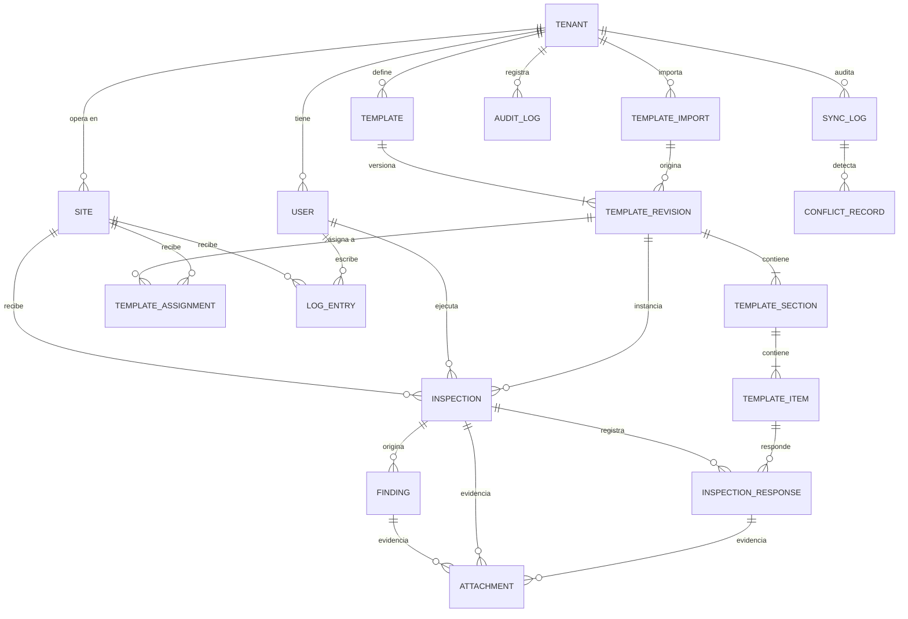

# DATA MODEL — Modelo conceptual de datos

**Versión:** 1.8.1 (Enmienda 008) · **Fecha:** 2026-09-14 · actualizado 2026-11-15 · **Autor:** Daniel Ávila · **Relacionado:** spec maestro §5/§7, specs 001–007, ADR-003
**Evidencia APT:** "Modelo conceptual de datos preliminar" (informe §6).
**Reglas transversales:** toda tabla de dominio lleva `tenant_id UUID NOT NULL` + política RLS (Artículo IV); IDs `UUIDv7` generados en el cliente cuando el registro nace offline (FR-015); timestamps `created_at`, `updated_at` (servidor) y `captured_at` (cliente, autoridad para LWW — FR-023).

## 1. Diagrama ER conceptual



## 2. Entidades por dominio

### 2.1 Tenancy y usuarios (spec 001)

**TENANT** — empresa cliente del SaaS.
| Campo | Tipo | Notas |
| :--- | :--- | :--- |
| id | UUID PK | |
| name | TEXT | "Minera El Cobre SpA" (demo) |
| slug | TEXT UNIQUE | URL/identificador legible |
| status | ENUM(active, suspended) | FR-050 |
| created_at | TIMESTAMPTZ | |

**USER** — cuenta de cualquier actor.
| Campo | Tipo | Notas |
| :--- | :--- | :--- |
| id | UUID PK | |
| tenant_id | UUID FK→TENANT | RLS; `platform_admin` tiene tenant NULL permitido (bypass auditado, §7 spec maestro) |
| email | CITEXT UNIQUE(tenant_id, email) | |
| password_hash | TEXT | argon2id (NFR-06) |
| role | ENUM(field_worker, supervisor, tenant_admin, platform_admin) | FR-003 |
| full_name | TEXT | |
| is_active | BOOLEAN | |
| failed_login_count | INT | bloqueo tras 5 credenciales fallidas (FR-005) |
| locked_until | TIMESTAMPTZ NULL | bloqueo temporal de 15 min (FR-005) |
| must_change_password | BOOLEAN NOT NULL DEFAULT false | clave temporal: obliga a cambiarla al primer ingreso (FR-055) |

**AUTH_SESSION** — refresh tokens con rotación por familia (D5).
| Campo | Tipo | Notas |
| :--- | :--- | :--- |
| id | UUID PK | |
| user_id | UUID FK→USER | |
| tenant_id | UUID FK→TENANT NULL | replicado del usuario para la RLS; `platform_admin` (tenant NULL) no es visible para ningún tenant |
| family_id | UUID | familia de rotación; el reuso de un token ya rotado revoca la familia y se audita (FR-051) |
| token_hash | TEXT UNIQUE | hash del refresh token, nunca el token |
| issued_at / expires_at | TIMESTAMPTZ | vigencia del refresh (30 días) |
| revoked_at | TIMESTAMPTZ NULL | revocación explícita o por detección de reuso |

**USER_SITE (faenas por cuenta)** *(Enmienda 008, FR-065, migración 021)* — `tenant_id UUID FK→TENANT, user_id UUID FK→USER, site_id UUID FK→SITE, created_by UUID FK→USER NULL, created_at`; PK `(user_id, site_id)`; RLS por `tenant_id`. Una cuenta **sin filas puede capturar en todas** las faenas de su empresa. La escribe sólo el `tenant_admin` (`PUT /users/:id/faenas`, reemplazo completo, auditado como `user_sites_updated`). Restringe `GET /sites` para `field_worker` y `supervisor`; la ingesta de sync no la consulta (Art. III).

**SITE (Faena/Obra)**
| Campo | Tipo | Notas |
| :--- | :--- | :--- |
| id, tenant_id | UUID | |
| name | TEXT | |
| kind | ENUM(mining, construction) | |
| location | GEOGRAPHY(Point) NULL | georreferencia opcional (FR-034) |

### 2.2 Plantillas e inspecciones (spec 004 / módulo 007)

**TEMPLATE (InspectionTemplate)** — cabecera del formulario.
| Campo | Tipo | Notas |
| :--- | :--- | :--- |
| id | UUID PK | |
| tenant_id | UUID FK→TENANT | RLS |
| name | TEXT | |
| description | TEXT NULL | |
| status | ENUM(active, archived) | baja lógica (§4.4). *(FR-066)* `archived` lo saca de `GET /templates` y del catálogo de los dispositivos; revisiones, asignaciones e inspecciones se conservan |
| created_at / updated_at | TIMESTAMPTZ | |

**TEMPLATE_REVISION** — contenido versionado e inmutable (módulo 007, FR-049).
| Campo | Tipo | Notas |
| :--- | :--- | :--- |
| id | UUID PK | |
| template_id | UUID FK→TEMPLATE | |
| tenant_id | UUID FK→TENANT | RLS |
| version | INT | **por plantilla**: `MAX(version)+1` dentro de su `template_id`. Es lo que ve el usuario ("v3 de la plantilla") |
| published_seq | BIGINT NULL | **secuencia GLOBAL de publicación** — cursor real del delta `since=` (FR-027). NULL en borradores; `CHECK (status <> 'published' OR published_seq IS NOT NULL)` |
| definition | JSONB | secciones + ítems completos (render offline, ADR-003) |
| status | ENUM(draft, published, archived) | se congela al publicar (FR-049) |
| source_import_id | UUID FK→TEMPLATE_IMPORT NULL | origen `.xlsx` si nació de un import |
| published_at | TIMESTAMPTZ NULL | |
| created_at | TIMESTAMPTZ | |

> **Por qué dos números (TSK-FORM-009, ADR-003 Enmienda 2).** `version` es por plantilla y el umbral del delta es uno solo para todo el tenant: con la plantilla A en v9 y la B en v3, comparar por `version` hace que la v4 de B **nunca llegue** al dispositivo. `published_seq` es monotónica global (huecos tolerados entre tenants), así que el delta nunca salta una revisión. El parámetro `since` no cambia de nombre ni de semántica —"última versión conocida"—; cambia el número que viaja. La redacción literal de FR-027 (`since=<template_version>`) se mantiene; la desviación está en ADR-003 Enmienda 2.

**TEMPLATE_IMPORT** — importación de documento (módulo 007, FR-029).
`id, tenant_id, uploaded_by UUID FK→USER, file_key TEXT, file_name TEXT, formato TEXT (xlsx, docx, pdf, jpg, png; migraciones 017/018), motor TEXT (reglas, ia; migración 018), status TEXT (uploaded, parsed, proposed, confirmed, failed), proposed_schema JSONB NULL (propuesta TemplateImportProposal validada con Zod compartido), error TEXT NULL, created_at TIMESTAMPTZ, updated_at TIMESTAMPTZ`. La revisión `draft` nacida del import se asocia por `source_import_id` y **solo se publica tras confirmación humana** (FR-029); RLS por `tenant_id`. `ATTACHMENT.owner_type` incluye `'template_import'`.

**TEMPLATE_ASSIGNMENT** — asignación faena+rol (FR-008/009).
`id, tenant_id, template_revision_id UUID FK→TEMPLATE_REVISION (published), site_id UUID FK→SITE NULL (NULL = todas las faenas), role ENUM(field_worker, supervisor), active BOOLEAN, assigned_by UUID FK→USER, assigned_at`. UNIQUE lógico `(template_revision_id, site_id, role)`, implementado con **dos índices únicos parciales** — `(template_revision_id, role) WHERE site_id IS NULL` y `(template_revision_id, site_id, role) WHERE site_id IS NOT NULL` — porque en PostgreSQL un `NULL` no colisiona en un `UNIQUE` simple y la asignación global quedaría sin proteger. `active = false` desactiva sin borrar (conserva `assigned_by`). El `field_worker` consulta solo revisiones publicadas asignadas a su faena y rol (FR-009): `GET /api/v1/templates?site_id=` filtra por rol operativo y acepta la asignación global (`site_id IS NULL`); el `tenant_admin` ve todo lo publicado y es quien asigna/desasigna. RLS por `tenant_id`.

**TEMPLATE_SECTION** — `id, revision_id UUID FK→TEMPLATE_REVISION, tenant_id UUID FK→TENANT, position INT, title TEXT`.

**TEMPLATE_ITEM** — `id, section_id UUID FK→TEMPLATE_SECTION, tenant_id UUID FK→TENANT, position, prompt TEXT, response_type ENUM(ok_nok_na, text, numeric, date, time, select_single, select_multiple, photo)` (8 tipos V1, FR-036), `require_finding_on_nok BOOLEAN, props JSONB NULL (min/max, options[], required, photo_max_kb), help TEXT`.

> `TEMPLATE_SECTION` y `TEMPLATE_ITEM` llevan `tenant_id` **denormalizado por fila** (patrón del repo, migración `1730000005000`): la política RLS aísla sin necesidad de joins y, sin `app.tenant_id`, no hay filas visibles.

**INSPECTION**
| Campo | Tipo | Notas |
| :--- | :--- | :--- |
| id | UUID PK (cliente, UUIDv7) | FR-015 |
| tenant_id, site_id | UUID FK | RLS por tenant |
| template_id | UUID | plantilla de la que deriva |
| template_version | INT | **congela la versión** al iniciar la inspección (FR-028/038); `template_id`+`version` identifican la revisión |
| executed_by | UUID FK→USER | |
| status | ENUM(draft, in_progress, submitted, reviewed) | FR-031 |
| captured_at | TIMESTAMPTZ (cliente) | autoridad LWW |
| synced_at | TIMESTAMPTZ NULL (servidor) | métrica de latencia NFR-03/FR-024 |
| location_lat | NUMERIC(10,8) NULL | georreferencia opcional (FR-034); sin PostGIS para V1 |
| location_lon | NUMERIC(11,8) NULL | georreferencia opcional (FR-034); sin PostGIS para V1 |
| client_version | INT | contador de edición local para conflictos |
| created_at / updated_at | TIMESTAMPTZ | servidor |

> **Congelado de versión.** La fila en base guarda `template_id` + `template_version` (no una columna `template_revision_id`); la revisión exacta se resuelve por ese par. El borrador del cliente sí persiste localmente el `revision_id` exacto para bloquear la captura si la revisión no llega (ADR-003 Enmienda 2, FR-028).

**INSPECTION_RESPONSE** — `id, inspection_id, template_item_id, tenant_id, value_ok ENUM(ok,nok,na) NULL, value_text NULL, value_number NULL, value_json JSONB NULL (select_single/select_multiple/date/time; validado contra `TEMPLATE_ITEM.props` antes de encolar, FR-039), captured_at, client_version`.

**FINDING (Hallazgo)** — `id, inspection_id NULL, response_id NULL, tenant_id, severity ENUM(low, medium, high, critical), description TEXT, status ENUM(open, in_progress, resolved), captured_at, client_version`. *(Enmienda 008, migración 020, FR-064)* Acción correctiva: `assignee_id UUID FK→USER NULL` (responsable, cuenta activa del mismo tenant), `due_date DATE NULL` (plazo), `resolution_note TEXT NULL` (≤ 2000, qué se hizo para cerrarlo). Las escribe sólo supervisión por `PATCH /findings/:id`; la ingesta de sync no las toca, así que una corrección del dispositivo no borra la asignación. `resolved_at` (migración 016) se fija al resolver y se limpia al reabrir.

**LOG_ENTRY (Bitácora)** — `id, site_id, author_id, tenant_id, entry_text TEXT, tags TEXT[], shift_date DATE, captured_at, client_version`.

**ATTACHMENT (Foto)** — `id, tenant_id, owner_type ENUM(inspection, finding, log_entry, response), owner_id, file_key TEXT, mime, bytes INT, width/height INT, captured_at, client_version`. `owner_type` incluye **`response`** (módulo 007, FR-037): la foto de un ítem se asocia a su respuesta. V1: `file_key` apunta a volumen Docker; evolución S3 documentada en research.md §6.

> **Extensión de la Enmienda 007 (FR-056…061, aprobada por Daniel Ávila el 2026-11-12).** `INSPECTION_SIGNATURE` y los indicadores de cierre de `INSPECTION` están implementados en la migración 019 y en revisión dentro de TSK-OPS-003-B (#191). `ASSET`, `INSPECTION_SCHEDULE`, `SCHEDULED_INSPECTION` y `NOTIFICATION_OUTBOX` permanecen diseñados, sin migración, hasta sus tareas posteriores.

**INSPECTION_SIGNATURE** — `id UUIDv7, tenant_id, inspection_id FK→INSPECTION, signer_id FK→USER, signer_role ENUM(inspector, supervisor), strokes_json JSONB, content_hash TEXT, declaration_version TEXT, signed_at TIMESTAMPTZ (cliente), client_version INT, created_at`. Un índice único `(inspection_id, signer_role)` evita duplicar la firma de cada rol. `strokes_json` lleva puntos vectoriales normalizados (enteros 0..1000 en un marco de 1000 × 500 con una sola escala, ≥2 puntos por trazo, ≤32 trazos, ≤1024 puntos; TSK-OFF-018), no una imagen de una firma ni datos biométricos; `content_hash` fija el contenido/ciclo de cierre que la persona declaró. RLS por tenant y auditoría de creación; no se permite reemplazo ni borrado desde `tc_app`.

**ASSET (activo o lugar)** — `id UUID, tenant_id, site_id FK→SITE, template_id FK→TEMPLATE, name TEXT, kind ENUM(vehicle, equipment, location), qr_token_hash TEXT UNIQUE, status ENUM(active, revoked), created_by FK→USER, created_at, updated_at`. El QR muestra el token aleatorio en claro sólo al generarlo; la base conserva su hash. `template_id` es una referencia estable: al resolver el QR se elige la revisión publicada que corresponda y se aplica de todos modos `TEMPLATE_ASSIGNMENT` por faena+rol. Regenerar QR invalida el token anterior y deja audit log.

**INSPECTION_SCHEDULE** — `id UUID, tenant_id, site_id FK→SITE, asset_id FK→ASSET NULL, template_id FK→TEMPLATE, assignee_id FK→USER NULL, cadence ENUM(once, daily, weekly, monthly), timezone TEXT, starts_at TIMESTAMPTZ, next_occurs_at TIMESTAMPTZ, due_after_minutes INT NULL, active BOOLEAN, created_by FK→USER, created_at, updated_at`. La zona horaria es IANA. El backend calcula fechas de pared, no suma 24 horas ciegamente, para respetar cambios de horario.

**SCHEDULED_INSPECTION** — `id UUID, tenant_id, schedule_id FK→INSPECTION_SCHEDULE, occurrence_at TIMESTAMPTZ, due_at TIMESTAMPTZ NULL, inspection_id FK→INSPECTION NULL, status ENUM(open, completed, missed, cancelled), created_at`. Índice único `(schedule_id, occurrence_at)` para que el worker y sus reintentos materialicen una sola ocurrencia. La inspección final referencia la ocurrencia sin cambiar la versión de plantilla que congeló al iniciarse.

**NOTIFICATION_OUTBOX** — `id UUID, tenant_id, event_type ENUM(schedule_created, schedule_due, schedule_overdue, inspection_submitted, critical_finding), recipient_user_id FK→USER NULL, recipient_email_snapshot CITEXT, idempotency_key TEXT UNIQUE, payload JSONB, status ENUM(pending, sending, delivered, failed), attempts INT, available_at TIMESTAMPTZ, delivered_at TIMESTAMPTZ NULL, last_error TEXT NULL, created_at`. El worker de correo consume únicamente esta tabla; las credenciales del proveedor permanecen en variables de entorno. El aviso se crea en la misma transacción que el evento y no bloquea la transacción de captura/sync.

### 2.3 Sincronización y auditoría (spec 003 / 006)

**SYNC_LOG** — `id, tenant_id, user_id, device_id UUID, batch_id UUID, records_total INT, records_ok INT, records_failed INT, started_at, finished_at, status ENUM(pending, ok, partial, failed), error_message TEXT NULL (≤500, motivo de un lote rechazado; TSK-OFF-018)`. Se abre en dos fases (`pending` → `UPDATE` con totales y `finished_at`, TSK-WS-009) para que `conflict_record.sync_log_id` referencie el batch. Satisface FR-024 y alimenta el dashboard (latencia media).

**CONFLICT_RECORD** — `id, tenant_id, entity_type, entity_id, winner_payload JSONB, loser_payload JSONB, resolution ENUM(lww), resolved_at, sync_log_id, reviewed_at NULL, reviewed_by NULL`. Ambas versiones conservadas (FR-023, Artículo III); append-only en su contenido (REVOKE DELETE desde `tc_app`, TSK-WS-009); sólo se registra quién lo revisó y cuándo (TSK-DOM-005).

**AUDIT_LOG** (append-only, FR-051) — `id, tenant_id NULL, actor_id, action TEXT, entity_type, entity_id, payload JSONB, occurred_at`. Sin UPDATE/DELETE (permisos DB).

### 2.4 Cliente local (IndexedDB/Dexie — no es PostgreSQL)

| Store | Contenido |
| :--- | :--- |
| `outbox` | Cola de sync: `{batchable records por entidad, status: pending/syncing/synced/failed, retries, last_error}` (FR-013, FR-020/22) |
| `inspections / responses / findings / logEntries / attachments(blobs)` | Copia local de trabajo offline (FR-011, FR-014) |
| `templates_cache` | Revisiones publicadas asignadas al trabajador (FR-018), para captura 100% offline |
| `meta` | sesión, tenant_id, device_id (UUID persistente del dispositivo), cuotas (FR-017) |

## 3. Multi-tenancy — implementación RLS

```sql
-- Patrón por tabla de dominio (ejemplo inspection)
ALTER TABLE inspection ENABLE ROW LEVEL SECURITY;
CREATE POLICY tenant_isolation ON inspection
  USING (tenant_id = current_setting('app.tenant_id', true)::uuid);
-- La app fija por transacción: SET LOCAL app.tenant_id = '<uuid del JWT>';
-- platform_admin: rol DB separado con bypass explícito, solo endpoints admin, auditado.
```

Índices mínimos: `(tenant_id, captured_at DESC)` en tablas de dominio; `(tenant_id, status)` en outbox/inspection; GIN sobre `tags` en log_entry.

## 4. Reglas de integridad clave

1. **Idempotencia de ingesta:** `INSERT ... ON CONFLICT (id) DO UPDATE ... WHERE excluded.client_version > inspection.client_version` (upsert por UUID cliente + versión → FR-021/023); aplica también a `template_import` (FR-029).
2. **Orden de dependencias del batch:** site → template (revisiones, imports, asignaciones) → inspection → responses → findings → log_entries → attachments → inspection_signature (Enmienda 007) (FR-020); un lote se rechaza completo si cruza tenants (FR-025).
3. **Latencia medida:** `synced_at - captured_at` por registro; agregado diario por tenant para dashboard (FR-040).
4. **Retención demo:** sin borrado físico; `is_active`/status para baja lógica.
5. **Congelamiento de revisiones:** `TEMPLATE_REVISION.published` es inmutable (sin UPDATE/DELETE desde `tc_app`); todo cambio exige una nueva revisión `draft → published` (FR-049). Las respuestas se validan contra `TEMPLATE_ITEM.props` en el dispositivo antes de encolar (FR-039).
6. **Delta de plantillas:** el cliente guarda el cursor `published_seq` máximo conocido por tenant (secuencia global de publicación, FR-027 / ADR-003 Enmienda 2) y tira solo el delta; una inspección en curso conserva su revisión congelada (`template_id` + `template_version`, FR-028/038) incluso si llega una versión nueva.

## 5. Datos semilla (sólo desarrollo y pruebas)

`backend/db/seed.ts` existe **sólo** para desarrollo local, tests de integración y E2E (Enmienda 003). Producción no se siembra: el primer `platform_admin` se crea con `infra/tools/bootstrap-admin.mjs` y las cuentas desde la app (FR-053/055). Contenido real del seed:

- Tenant A "Minera El Cobre SpA": 1 faena, 1 plantilla (chequeo de seguridad minera: revisión borrador + publicada con los 8 tipos de respuesta), 3 usuarios (field_worker, supervisor, tenant_admin) y asignaciones por faena/rol.
- Tenant B "Constructora Andes SpA": 1 obra, 1 plantilla (inspección de obra), 3 usuarios (field_worker, supervisor, tenant_admin) — existe para probar aislamiento en vivo (spec maestro §7).
- 1 `platform_admin` global.
- Sin inspecciones históricas ni `TEMPLATE_IMPORT` precargados: las pruebas crean los suyos.

## 6. Control de cambios

| Versión | Fecha | Cambio |
| :--- | :--- | :--- |
| 1.8.1 | 2026-11-15 | **TSK-OFF-018 (FR-024, FR-056):** migración 022 — `sync_log.error_message` guarda el motivo de un lote rechazado; marco y límites de `strokes_json` documentados |
| 1.8.0 | 2026-11-14 | **Enmienda 008 (FR-065, TSK-ADM-003):** migración 021 — tabla `user_site` con RLS (faenas por cuenta) |
| 1.7.1 | 2026-11-14 | **FR-066 (TSK-FORM-024):** uso de `template.status = archived` para archivar formularios; sin migración |
| 1.0.0 | 2026-09-14 | Modelo base (specs 001–006) |
| 1.6.0 | 2026-11-12 | **Enmienda 007** (aprobada por Daniel Ávila el 2026-11-12): modelo previo a implementación para `inspection_signature`, `asset`, `inspection_schedule`, `scheduled_inspection` y `notification_outbox`; RLS, inmutabilidad e idempotencia explícitas | Raúl González (con IA) |
| 1.7.0 | 2026-11-13 | **Enmienda 008 (FR-064, TSK-DOM-007):** migración 020 — `finding.assignee_id`, `due_date`, `resolution_note` e índice parcial por responsable |
| 1.6.1 | 2026-11-12 | **TSK-OPS-003-B (#191, en revisión):** migración 019 para `inspection_signature`, RLS/inmutabilidad y banderas de cierre en `inspection`; los demás objetos de la Enmienda 007 continúan planificados |
| 1.5.0 | 2026-11-11 | **Enmienda 006:** `template_imports.motor` y formatos `jpg`/`png` (migración 018); `audit_log` registra `template_import_ia` | Daniel Ávila (con IA) |
| 1.4.0 | 2026-11-11 | **Enmienda 005:** `template_imports.formato` (migración 017); el archivo fuente se guarda con su extensión y MIME reales | Daniel Ávila (con IA) |
| 1.3.0 | 2026-11-11 | **Enmienda 004:** `auth_session.revoked_reason` (migración 015, sesión reemplazada); `inspection.queued_at` / `client_sent_at` / `reviewed_at` y `finding.resolved_at` (migración 016, métricas del dashboard de supervisión, TSK-REP-006). `inspection.location` queda en desuso | Daniel Ávila (con IA) |
| 1.2.0 | 2026-11-11 | **v1 (Enmienda 003):** `app_user.must_change_password` (clave temporal, migración 012); `conflict_record.reviewed_at` / `reviewed_by` (revisión persistente, migración 014); RLS de `audit_log` y `auth_session` sin filas `tenant_id IS NULL` para el rol de la app (migración 013); §5 describe el seed real y lo limita a desarrollo/pruebas |
| 1.1.4 | 2026-10-14 | **FR-034 implementado:** `inspection.location_lat` / `inspection.location_lon` (NUMERIC, sin PostGIS) para georreferencia opcional capturada en terreno; el campo viaja de forma aditiva en `POST /api/v1/sync/batch` y se valida en el servidor |
| 1.1.3 | 2026-10-12 | **Coherencia con el esquema real (módulo 007):** se retira `inspection.template_revision_id` (la base congela `template_id` + `template_version`) y `inspection.geo` (no existe en la migración); `TEMPLATE_SECTION`/`TEMPLATE_ITEM` recuperan su `tenant_id` denormalizado; se documenta `AUTH_SESSION`; `app_user` suma `failed_login_count`/`locked_until`; la regla 6 pasa a hablar de `published_seq` como cursor del delta |
| 1.1.2 | 2026-10-10 | **Módulo 007 (TSK-FORM-009, PR #89):** `TEMPLATE_REVISION.published_seq` (secuencia global de publicación) como cursor del delta FR-027, con backfill determinista, índice parcial y `CHECK (status <> 'published' OR published_seq IS NOT NULL)`; `version` queda documentada como por plantilla. Se registra la desviación respecto de la redacción literal de FR-027 (`since=<template_version>`) — ver ADR-003 Enmienda 2 |
| 1.1.1 | 2026-10-10 | `TEMPLATE_ASSIGNMENT` materializada (TSK-FORM-008, PR #87): `active` para desactivar sin borrar y único lógico `(template_revision_id, site_id, role)` implementado con dos índices únicos parciales (`site_id IS NULL` / `IS NOT NULL`) para que la asignación global (`site_id NULL` = todas las faenas) también quede protegida |
| 1.1.0 | 2026-10-07 | **Módulo 007 (Enmienda 002):** `TEMPLATE_REVISION` inmutable (draft/published/archived, `source_import_id`), `TEMPLATE_IMPORT` (uploaded/parsed/proposed/confirmed/failed, `proposed_schema`), `TEMPLATE_ASSIGNMENT` (faena/rol); `TEMPLATE_ITEM` ampliado a 8 `response_type` + `props JSONB`; `INSPECTION_RESPONSE` +`value_json JSONB`; `ATTACHMENT.owner_type` +`response`; inspección congela la versión de la plantilla (`template_id` + `version`) |
