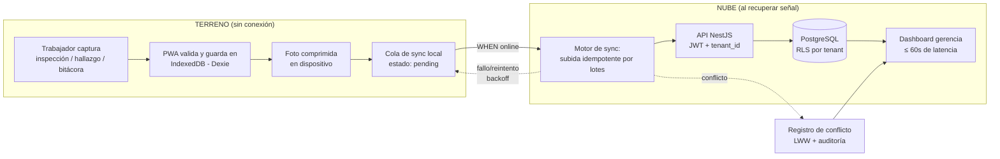

# SPEC MAESTRO — Terreno Conectado, Datos al día donde no hay señal

| | |
| :--- | :--- |
| **ID** | 000-master |
| **Versión** | 1.7.0 · Enmienda 008 (evidencia visible en supervisión) |
| **Estado** | APROBADO — Raúl González (2026-09-24) y Daniel Ávila (2026-10-13) · Enmiendas 003–006 firmadas por Daniel Ávila, pendientes de ratificación de Raúl González · Enmienda 007 propuesta por Raúl González y aprobada por Daniel Ávila el 2026-11-12; B está en revisión y C–E se implementan por tareas · Enmienda 008 firmada por Daniel Ávila el 2026-11-13, pendiente de ratificación de Raúl González |
| **Autores** | Daniel Ávila (datos/negocio) · Raúl González (infra/plataforma) |
| **Fuente** | Informe de Definición APT, Fase 1 (2026-09-04) |
| **Specs derivados** | 001-auth-tenancy · 002-captura-offline · 003-motor-sincronizacion · 004-dominio-inspecciones · 005-reportes-gerencia · 006-admin-plataforma · 007-formularios-dinamicos |

> Este documento concentra ~70–80% de la definición del proyecto: visión, actores, módulos, requisitos funcionales (EARS), requisitos no funcionales, modelo multi-tenant, límites de alcance, MVP, criterios de aceptación de la demo y mapeo a evidencias APT. Los specs de módulo profundizan el 20–30% restante.

---

## 1. Problema y contexto

Faenas mineras y obras de construcción remotas en Chile operan gran parte de su superficie **sin cobertura de red estable**. Los equipos de terreno registran inspecciones, bitácoras y datos operacionales en papel o planillas. Consecuencias (fundamentadas en el informe APT §3.1):

- La gerencia decide con información desactualizada (brecha de días entre captura y disponibilidad).
- Trabajo administrativo duplicado (horas-hombre perdidas en transcripción y consolidación).
- Riesgos de seguridad que pasan inadvertidos más tiempo del debido.
- Reportes inconsistentes entre sistemas.

**Propuesta de valor:** reducir la brecha de tiempo entre la captura del dato en terreno y su disponibilidad para la toma de decisiones, mediante una plataforma SaaS offline-first multi-empresa.

## 2. Actores / Personas

| Actor | Contexto | Necesidad clave |
| :--- | :--- | :--- |
| **Trabajador de terreno** | Faena/obra sin conectividad; teléfono o tablet gama media; guantes, polvo, luz solar | Capturar rápido y sin fricción, confiar en que nada se pierde |
| **Supervisor / Jefe de faena u obra** | Se mueve entre terreno y oficina; consolida lo del equipo | Ver el estado del turno, revisar hallazgos, validar inspecciones |
| **Gerencia / Planificación** | Oficina central; no pisa terreno | Dashboards y reportes confiables, al día, exportables |
| **Admin de tenant (empresa cliente)** | Oficina del cliente | Gestionar sus usuarios, faenas y plantillas de inspección |
| **Admin de plataforma** | Nosotros (operador del SaaS) | Crear tenants, ver salud del sistema, auditar |

## 3. Visión de la solución

Aplicación web **PWA offline-first**: el trabajador captura inspecciones, hallazgos (con foto comprimida) y bitácora en el dispositivo aunque esté en modo avión; los datos viven primero en IndexedDB y se encolan; **apenas vuelve la señal, una cola de sincronización idempotente sube todo sin acción del usuario**; el backend (monolito NestJS + PostgreSQL con RLS) consolida por tenant y la gerencia lo ve en dashboards en ≤ 60 s desde la reconexión. Un mismo despliegue sirve a varias empresas cliente con datos completamente aislados.

### 3.1 Flujo de captura → decisión (boceto del flujo — evidencia APT)

## 4. Módulos del sistema

| # | Módulo | Spec | Autor | Resumen |
| :--- | :--- | :--- | :--- | :--- |
| 001 | Autenticación y tenancy | `specs/001-auth-tenancy/` | Raúl | Login, JWT con claim de tenant, roles, aislamiento |
| 002 | Captura offline (PWA) | `specs/002-captura-offline/` | Daniel | Formularios offline, IndexedDB, fotos comprimidas, cola local |
| 003 | Motor de sincronización | `specs/003-motor-sincronizacion/` | Daniel | Sync idempotente, reintentos, conflictos, auditoría |
| 004 | Dominio inspecciones | `specs/004-dominio-inspecciones/` | Daniel | Plantillas, inspecciones, hallazgos, bitácoras, faenas |
| 005 | Reportes y gerencia | `specs/005-reportes-gerencia/` | Daniel | Dashboards, latencia captura→disponibilidad, export CSV |
| 006 | Administración plataforma | `specs/006-admin-plataforma/` | Raúl | Gestión de tenants, usuarios, auditoría, health |
| 007 | Formularios dinámicos desde documentos | `specs/007-formularios-dinamicos/` *(por crear)* | Pair | Import de plantillas desde `.xlsx` con revisión humana, asignación por faena/rol, captura offline data-driven y export del documento rellenado |

## 5. Requisitos funcionales (formato EARS)

Convención EARS en español: ubicuo (`EL SISTEMA DEBERÁ…`), evento (`CUANDO…`), estado (`MIENTRAS…`), no deseado (`SI… ENTONCES…`), opcional (`DONDE…`).

> **Nota de numeración:** los IDs FR se numeran por bloques de módulo, dejando huecos **reservados** a propósito para ampliaciones futuras sin renumerar. La **Enmienda 002** (módulo 007 — formularios dinámicos) ocupó los bloques **007–009, 018–019, 027–029, 036–039 y 044–049**; la **Enmienda 007** ocupa el bloque **056–061** para operación certificada; la **Enmienda 008** abre el bloque **062–069** para el plan de mejora de producto.

### 5.1 Módulo 001 — Autenticación y tenancy

- **FR-001** EL SISTEMA DEBERÁ autenticar usuarios con email y contraseña (hash argon2/bcrypt) y emitir un JWT de corta duración con claims `user_id`, `tenant_id`, `rol`.
- **FR-002** CUANDO un usuario se autentica, EL SISTEMA DEBERÁ restringir todo acceso a datos de su propio tenant mediante Row-Level Security en PostgreSQL.
- **FR-003** EL SISTEMA DEBERÁ soportar los roles: `field_worker`, `supervisor`, `tenant_admin`, `platform_admin`, con permisos crecientes definidos en el spec 001.
- **FR-004** CUANDO el JWT expira, EL SISTEMA DEBERÁ permitir renovación con refresh token sin perder la cola de sync local pendiente.
- **FR-005** SI las credenciales son inválidas 5 veces consecutivas, ENTONCES EL SISTEMA DEBERÁ aplicar un bloqueo temporal de 15 minutos (rate-limit por cuenta e IP).
- **FR-006** EL SISTEMA DEBERÁ incluir un tenant demo sembrado (empresa ficticia, faena ficticia, usuarios de cada rol) para la demostración académica.
- **FR-007** EL SISTEMA DEBERÁ aislar las plantillas de formularios y sus versiones por tenant (Row-Level Security, Artículo IV), de modo que un tenant jamás vea plantillas de otro.
- **FR-008** EL SISTEMA DEBERÁ permitir al `tenant_admin` asignar plantillas publicadas a combinaciones de faena y rol (`TEMPLATE_ASSIGNMENT`) y desasignarlas.
- **FR-009** CUANDO un `field_worker` autenticado consulta plantillas, EL SISTEMA DEBERÁ devolver únicamente las plantillas publicadas asignadas a su faena y su rol.

### 5.2 Módulo 002 — Captura offline (PWA)

- **FR-010** EL SISTEMA DEBERÁ ser una PWA instalable (manifest + service worker) que funciona sin red tras la primera carga.
- **FR-011** MIENTRAS el dispositivo no tiene conectividad, EL SISTEMA DEBERÁ permitir crear y editar inspecciones, respuestas de checklist, hallazgos (texto + foto) y entradas de bitácora, guardándolos en IndexedDB (Dexie).
- **FR-012** CUANDO el trabajador adjunta una foto, EL SISTEMA DEBERÁ comprimirla en el dispositivo (máx. 1280 px lado mayor, calidad 0.7, configurable) antes de encolarla; DONDE el feature flag `photos` esté desactivado, EL SISTEMA DEBERÁ ocultar la captura fotográfica.
- **FR-013** EL SISTEMA DEBERÁ mostrar el estado de cada registro local: `pending`, `syncing`, `synced`, `failed`, con contador visible de pendientes.
- **FR-014** EL SISTEMA DEBERÁ conservar los datos locales no sincronizados al cerrar y reabrir la aplicación (incl. reinicio del dispositivo).
- **FR-015** EL SISTEMA DEBERÁ generar identificadores UUIDv7 en el cliente para cada registro, de modo que la sincronización posterior no dependa de IDs asignados por el servidor.
- **FR-016** CUANDO el navegador recupera conectividad (evento `online`), EL SISTEMA DEBERÁ iniciar la sincronización automáticamente sin acción del usuario.
- **FR-017** SI el almacenamiento local supera el 80% de la cuota estimada, ENTONCES EL SISTEMA DEBERÁ advertir al trabajador y priorizar la subida de fotos ya sincronizables.
- **FR-018** EL SISTEMA DEBERÁ mantener una caché local de las plantillas publicadas asignadas al trabajador, de modo que la captura de formularios funcione 100% sin conexión (Artículo I).
- **FR-019** CUANDO el trabajador exporta una inspección en el dispositivo, EL SISTEMA DEBERÁ generar el `.xlsx` original rellenado más una hoja "Evidencias" con los adjuntos, sin depender del servidor (Artículo I).

### 5.3 Módulo 003 — Motor de sincronización

- **FR-020** CUANDO hay conectividad y registros en estado `pending`, EL SISTEMA DEBERÁ subirlos por lotes (batch) respetando el orden de dependencias (faena → inspección → respuestas → hallazgos → fotos).
- **FR-021** EL SISTEMA DEBERÁ ser idempotente: reintentar un lote ya procesado (total o parcialmente) no crea duplicados (upsert por UUID cliente).
- **FR-022** SI un lote falla por red, ENTONCES EL SISTEMA DEBERÁ reintentarlo con backoff exponencial (1 s → 2 s → 4 s → … máx. 5 min) sin intervención del usuario.
- **FR-023** SI dos dispositivos editan el mismo registro offline, ENTONCES EL SISTEMA DEBERÁ resolver con Last-Write-Wins basado en `captured_at`/`updated_at`, conservando ambas versiones en un registro de conflictos visible para el supervisor.
- **FR-024** EL SISTEMA DEBERÁ registrar cada sincronización (éxito/fallo/conflicto) en un log auditable por tenant con métrica de latencia `captured_at → synced_at`.
- **FR-025** SI un intento de sync incluye datos de un tenant distinto al del JWT, ENTONCES EL SISTEMA DEBERÁ rechazar el lote completo y registrar el incidente (defensa en profundidad sobre RLS).
- **FR-026** CUANDO la sincronización termina, EL SISTEMA DEBERÁ marcar los registros locales como `synced` y actualizar el contador de pendientes.
- **FR-027** CUANDO el worker de sincronización ejecuta el ciclo, EL SISTEMA DEBERÁ sincronizar plantillas por delta mediante `GET /api/v1/templates?since=<template_version>`, subiendo solo los cambios posteriores a la última versión conocida.
  > **Nota de implementación (TSK-FORM-009, 2026-10-10):** el cursor que viaja en `since` es `TEMPLATE_REVISION.published_seq` —una **secuencia global de publicación**— y no el campo `version`. `version` se asigna **por plantilla** (`MAX(version)+1` dentro de su `template_id`), así que un umbral global la saltaba: con la plantilla A en v9 y la B en v3, comparar contra `version` hacía que la v4 de B **nunca llegara** al dispositivo y el delta dejaba de garantizar una respuesta completa. `version` se conserva intacto para lo que ve el usuario; el parámetro no cambia de nombre ni de sentido ("última versión conocida"), cambia el número que viaja. Detalle del esquema, backfill y la restricción que impide publicar sin secuencia: `data-model.md` v1.1.2 y `adr/003-formularios-dinamicos.md` Enmienda 2.
- **FR-028** SI una inspección está en curso y su plantilla cambia, ENTONCES EL SISTEMA DEBERÁ conservar la `template_version` congelada de la inspección (no se re-encuadra ni se re-valida contra la plantilla nueva); el cambio aplica solo a inspecciones nuevas.
- **FR-029** EL SISTEMA DEBERÁ sincronizar los imports de plantilla (`TEMPLATE_IMPORT`: uploaded → parsed → proposed → confirmed/failed) con UUIDv7 de cliente y el mismo motor idempotente de batch, de modo que reintentar nunca duplique (Artículo III).

### 5.4 Módulo 004 — Dominio inspecciones

- **FR-030** EL SISTEMA DEBERÁ permitir al `tenant_admin` definir plantillas de inspección: secciones e ítems con tipos de respuesta `ok/nok/na`, texto, numérico y foto obligatoria/opcional.
- **FR-031** EL SISTEMA DEBERÁ gestionar el ciclo de vida de una inspección: `draft → in_progress → submitted → reviewed`.
- **FR-032** CUANDO un ítem se responde `nok`, EL SISTEMA DEBERÁ exigir (configurable por plantilla) un hallazgo asociado con severidad (`baja/media/alta/crítica`), descripción y evidencia fotográfica opcional.
  > **Nota de implementación (TSK-OFF-007, 2026-11-13):** la respuesta `nok` de un ítem tiene **un** hallazgo; corregirlo en el dispositivo actualiza ese registro (mismo UUID, `client_version` mayor) en vez de crear otro. La severidad la elige la persona (sin valor por omisión) y la descripción es obligatoria para `alta` y `crítica`. No cambia el texto ni el alcance del requisito. Detalle en `specs/004-dominio-inspecciones/spec.md` §5.
- **FR-033** EL SISTEMA DEBERÁ permitir registrar bitácoras de turno: entradas cronológicas con autor, texto, tags y faena asociada.
- **FR-034** EL SISTEMA DEBERÁ asociar cada captura (inspección/bitácora/hallazgo) a una faena u obra del tenant, con geolocalización opcional si el dispositivo la provee. *(Enmienda 004: la geolocalización sale de V1; la asociación a faena/obra se mantiene.)*
- **FR-035** CUANDO un hallazgo de severidad `alta` o `crítica` se sincroniza, EL SISTEMA DEBERÁ destacarlo inmediatamente en el dashboard del supervisor (sin notificaciones push en V1 — fuera de alcance).
- **FR-036** EL SISTEMA DEBERÁ soportar respuestas dinámicas por ítem mediante `value_json` en `INSPECTION_RESPONSE` para los 8 tipos de campo de V1: `texto`, `numérico`, `fecha`, `hora`, `selección única`, `selección múltiple`, `ok/nok/na` y `foto`.
- **FR-037** CUANDO un ítem de tipo foto se responde, EL SISTEMA DEBERÁ comprimir el adjunto (FR-012) y asociarlo a la respuesta (`ATTACHMENT` referenciando `INSPECTION_RESPONSE`).
- **FR-038** EL SISTEMA DEBERÁ congelar en cada inspección la `template_version` utilizada y conservarla en el historial para reproductibilidad de la respuesta.
- **FR-039** SI la respuesta a un ítem no cumple el tipo definido por la plantilla, ENTONCES EL SISTEMA DEBERÁ rechazarla en el dispositivo y mostrar el error de validación antes de encolar.
- **FR-056** ANTES de enviar una inspección cerrada, EL SISTEMA DEBERÁ exigir la firma manuscrita en pantalla de la persona inspectora, asociada a su sesión autenticada, la versión congelada de la plantilla y el contenido que declara haber completado; dicha firma DEBERÁ poder capturarse, persistirse y encolarse sin red.
- **FR-057** DONDE la revisión de plantilla configure cofirma de supervisión, EL SISTEMA DEBERÁ exigir la firma manuscrita posterior de un `supervisor` o `tenant_admin` de la misma empresa antes de que la inspección pueda pasar a `reviewed`; ninguna cuenta podrá firmar por otro rol ni sustituir una firma ya registrada.
- **FR-058** CUANDO se programe, venza, se cierre una inspección o se sincronice un hallazgo crítico, EL SISTEMA DEBERÁ crear un aviso de correo para los destinatarios configurados, con clave idempotente, trazabilidad y reintentos; la captura y el cierre nunca dependerán de que el envío de correo funcione.
- **FR-059** EL SISTEMA DEBERÁ permitir al `tenant_admin` programar inspecciones puntuales o recurrentes por faena, plantilla, activo/lugar y responsable, conservando una zona horaria IANA y materializando cada ocurrencia una sola vez.
- **FR-060** EL SISTEMA DEBERÁ permitir al `tenant_admin` registrar activos o lugares de su empresa con un identificador QR opaco y revocable, asociado a una plantilla; un QR resuelto sólo abrirá una plantilla publicada que esté asignada a la faena y al rol de quien lo escanea.
- **FR-061** EL SISTEMA DEBERÁ proporcionar escaneo por cámara y entrada manual de QR; los nuevos datos de firma, programación, avisos y activos DEBERÁN mantener UUIDv7 cuando nazcan en cliente, RLS, auditoría e idempotencia de sincronización.

### 5.5 Módulo 005 — Reportes y gerencia

- **FR-040** EL SISTEMA DEBERÁ ofrecer un dashboard por tenant con: inspecciones del período por estado, hallazgos por severidad, pendientes de sincronización conocidos y latencia media captura→disponibilidad.
- **FR-041** EL SISTEMA DEBERÁ permitir filtrar por faena, rango de fechas, severidad y autor.
- **FR-042** EL SISTEMA DEBERÁ exportar las vistas del dashboard y el listado de inspecciones/hallazgos a CSV.
- **FR-043** CUANDO un dato se sincroniza, EL SISTEMA DEBERÁ hacerlo visible en el dashboard en ≤ 60 segundos (ver NFR-03).
- **FR-044** EL SISTEMA DEBERÁ permitir al supervisor descargar una inspección como el `.xlsx` original rellenado más la hoja "Evidencias", generado en servidor (mismo formato que FR-019).
- **FR-045** EL SISTEMA DEBERÁ exportar en lote las inspecciones del período a un `.xlsx` con el formato de su plantilla.
- **FR-046** CUANDO se exporta un lote, EL SISTEMA DEBERÁ incluir la hoja "Evidencias" con los adjuntos de los ítems de evidencia (fotos), referenciados o embebidos según tamaño.
- **FR-047** EL SISTEMA DEBERÁ registrar en el audit log (FR-051) cada import de plantilla confirmado y cada exportación por lote (autor, timestamp, tenant, identificadores).
- **FR-048** DONDE el feature flag `ai` esté activado, EL SISTEMA DEBERÁ proponer mapeos de columnas automáticos en la revisión humana del import, ejecutándose solo en backend; el `tenant_admin` conserva la decisión final.
- **FR-049** CUANDO una plantilla se publica, EL SISTEMA DEBERÁ congelar su `template_version` e impedir modificar ítems ya inspeccionados; cualquier cambio requiere una nueva revisión (`draft` → `published`).
- **FR-062** *(Enmienda 008)* EL SISTEMA DEBERÁ permitir al `supervisor` y al `tenant_admin` ver en pantalla la evidencia fotográfica de las respuestas y de los hallazgos de su empresa, sin necesidad de exportar un archivo; el acceso a cada foto DEBERÁ respetar el aislamiento por tenant (RLS) y los roles del dashboard.

### 5.6 Módulo 006 — Administración plataforma

- **FR-050** EL SISTEMA DEBERÁ permitir al `platform_admin` crear tenants, asignarles `tenant_admin` inicial y habilitar/deshabilitar el tenant.
- **FR-051** EL SISTEMA DEBERÁ registrar en un audit log inmutable (append-only) las operaciones críticas: creación de tenant, cambios de rol, conflictos de sync, intentos cross-tenant.
- **FR-052** EL SISTEMA DEBERÁ exponer un endpoint `/health` (uptime, versión, estado de DB) consumible por el monitoreo (QA).
- **FR-053** *(Enmienda 003)* EL SISTEMA DEBERÁ permitir al `tenant_admin` crear las cuentas de su empresa (`field_worker`, `supervisor`, `tenant_admin`) con una clave temporal, cambiar su rol, desactivarlas/reactivarlas y restablecer su clave; nunca puede desactivarse a sí mismo ni dejar la empresa sin administrador activo. Cada cambio queda en el audit log.
- **FR-054** *(Enmienda 003)* EL SISTEMA DEBERÁ permitir al `tenant_admin` crear y renombrar las faenas de su empresa.
- **FR-055** *(Enmienda 003)* CUANDO un usuario ingresa con clave temporal, EL SISTEMA DEBERÁ exigirle reemplazarla antes de cualquier otra acción; todo usuario DEBERÁ poder cambiar su clave y cerrar sesión, revocando la sesión en el servidor.

## 6. Requisitos no funcionales

| ID | Categoría | Requisito |
| :--- | :--- | :--- |
| **NFR-01** | Offline-first | 100% del flujo de captura opera sin red (Artículo I de la constitución). |
| **NFR-02** | Capacidad offline | ≥ 72 h continuas offline con ≥ 200 registros y ≥ 100 fotos sin pérdida ni corrupción. |
| **NFR-03** | Latencia de sync | Tras reconexión con conectividad normal (≥ 5 Mbps), cola completa de 72 h sincronizada y visible en dashboard en ≤ 5 min; primer lote visible en ≤ 60 s. |
| **NFR-04** | Integridad | Cero pérdida y cero duplicación bajo las pruebas de caos del test-plan (Artículo III). |
| **NFR-05** | Aislamiento | Ninguna consulta devuelve datos de otro tenant (RLS probado en CI, Artículo IV). |
| **NFR-06** | Seguridad | TLS obligatorio (Caddy), argon2/bcrypt para contraseñas, JWT ≤ 15 min + refresh, secretos fuera del repo, checklist OWASP Top 10 en revisión de PRs. |
| **NFR-07** | Rendimiento cliente | PWA usable en Android gama media (4 GB RAM, Chrome ≥ 100): Lighthouse Performance ≥ 80 (mobile), interacción < 200 ms en formularios. |
| **NFR-08** | Presupuesto | Infraestructura demo ≤ US$7/mes (Artículo VI). Sin servicios de pago no documentados. |
| **NFR-09** | Observabilidad | `/health`, uptime monitoring externo (free tier), logs estructurados JSON con `tenant_id` y `request_id`. |
| **NFR-10** | Idiomas | Documentación en español; código, tests, commits, variables y CI en inglés. UI de la app en español (es-CL). |
| **NFR-11** | Simplicidad | Monolito NestJS + PWA React; un solo lenguaje (TypeScript); dependencias justificadas en research.md (Artículo V). |
| **NFR-12** | Trazabilidad SDD | 100% de tasks referencian FR/NFR; 100% de FR con al menos un test (Artículos II y VII). |

## 7. Modelo multi-tenant

- **Estrategia:** base de datos compartida, esquema compartido, discriminador `tenant_id` en toda tabla de dominio + **Row-Level Security de PostgreSQL** como mecanismo de aislamiento (defensa primaria). La aplicación filtra además por tenant (defensa secundaria).
- **Cadena de confianza:** login → JWT con `tenant_id` → conexión DB fija `app.tenant_id` vía `SET LOCAL` por transacción → políticas RLS `USING (tenant_id = current_setting('app.tenant_id')::uuid)`.
- **`platform_admin`:** rol fuera de RLS de tenant (bypass explícito y auditado) solo para administración.
- **Datos por tenant:** usuarios, faenas, plantillas, inspecciones, hallazgos, bitácoras, conflictos, auditoría.
- **Demo:** tenant semilla "Minera El Cobre SpA" + tenant semilla "Constructora Andes SpA" para probar aislamiento en vivo (Artículo IV / evidencia).

Detalle físico (tablas, índices, políticas): `data-model.md`.

## 8. Stack tecnológico (resumen — decisión completa en ADR-001 y research.md)

| Capa | Tecnología |
| :--- | :--- |
| Frontend | PWA: React 18 + Vite + TypeScript, Dexie (IndexedDB), Workbox (service worker) |
| Backend | NestJS (Node + TypeScript), monolito modular, REST |
| Base de datos | PostgreSQL 16 + Row-Level Security; IDs UUIDv7 |
| Sync | Cola propia cliente (Dexie) + endpoints idempotentes de ingesta por lotes; LWW + registro de conflictos |
| Fotos | Compresión en cliente (canvas), objetos en disco del VPS (V1); S3-compatible documentado como evolución |
| Infra demo | 1 VPS (Hetzner/Fly ~US$5/mes) + Docker Compose + Caddy (TLS automático) + Postgres en el mismo VPS |
| CI/CD | GitHub Actions: lint → test (unit+E2E) → build → deploy (SSH/compose up) |
| QA/Monitoreo | `/health` + uptime monitor externo free-tier + logs JSON |
| Testing | Vitest (unit), Playwright (E2E), pruebas de caos offline, red-team adversarial cross-model |

## 9. MVP — bucle mínimo vertical (walking skeleton)

El MVP demuestra la promesa completa de punta a punta:

1. `field_worker` inicia sesión (tenant demo) y la PWA queda operativa offline.
2. En modo avión: crea una inspección desde plantilla, responde checklist, registra un hallazgo `nok` con foto comprimida y una entrada de bitácora. Cierra la app, la reabre: todo sigue ahí.
3. Al reconectar, la cola sincroniza sola; estados pasan a `synced`.
4. En ≤ 60 s el `supervisor` ve la inspección y el hallazgo destacado en el dashboard.
5. Prueba en vivo de aislamiento: el usuario del segundo tenant no ve nada del primero.
6. Prueba en vivo de conflicto: dos dispositivos editan la misma inspección offline → al sincronizar, LWW aplica y el conflicto queda visible y auditado.

## 10. Límites de alcance (fuera de V1)

Fuera de alcance explícito — cualquier inclusión requiere enmienda a este spec (Artículo X de la constitución):

- Facturación/cobranza del SaaS (solo se documenta el modelo de negocio conceptual).
- Apps móviles nativas (iOS/Android stores).
- SSO corporativo (SAML/OIDC con el IdP del cliente).
- Notificaciones push.
- Colaboración en tiempo real (edición simultánea con merge fino/CRDT — V1 usa LWW + auditoría).
- OCR de formularios de papel escaneados y analítica con IA — **V2 opcional** *(Enmienda 005: importar Word `.docx` y PDF con texto o rellenable entra en V1.2. Enmienda 006: leer fotos de pautas en papel y PDF escaneados entra en V1.3 con un motor de IA opcional; la analítica con IA sigue en V2)* tras feature flag `ai` (off por defecto, ejecución solo en backend; ver FR-048 y ADR-003).
- Integración con ERPs mineros reales.
- Despliegue productivo multi-región, alta disponibilidad, backups gestionados (se documentan como diseño "real" en ADRs, no se pagan).
- Alta self-service de empresas, invitaciones y recuperación de clave por correo (V1 usa clave temporal entregada por un administrador; FR-053/055).
- Modo demo o cuentas compartidas en el producto: las cuentas semilla existen sólo para desarrollo y pruebas (Enmienda 003).

> **Enmienda 002 (2026-10-07, módulo 007):** incorpora a V1 la **importación asistida de plantillas** desde `.xlsx` estructurado con **revisión humana obligatoria** y la **exportación del documento rellenado** (FR-007–009, 018–019, 027–029, 036–039, 044–049; spec `007-formularios-dinamicos`). El OCR/IA queda en V2 opcional (bala anterior).

> **Enmienda 003 (2026-11-11, v1 como producto entregable).** Cierra la v1 con lo construido más lo mínimo para operar con clientes reales:
>
> - **Entra a V1:** FR-053 (cuentas de la empresa por su `tenant_admin`), FR-054 (faenas) y FR-055 (clave temporal con cambio obligatorio, cambio de clave y cierre de sesión con revocación). El primer `platform_admin` se crea con un comando interactivo en el servidor (`infra/tools/bootstrap-admin.mjs`).
> - **Sale el modo demo:** sin cuentas ni clave compartida en la app, sin interruptor de señal simulado ni limpieza de datos de prueba. El estado de señal es el de la red real.
> - **Aclaraciones de alcance (lo construido, sin recortar calidad — Art. X):**
>   - **FR-012:** se elimina el feature flag `photos`; la captura fotográfica está siempre disponible.
>   - **FR-029:** el import de plantillas es una acción **en línea** del `tenant_admin` (no viaja por la cola offline ni usa UUIDv7 de cliente); su idempotencia práctica es la revisión humana antes de confirmar. Reintentar una subida crea una propuesta nueva que no publica nada por sí sola.
>   - **FR-040:** "pendientes de sincronización conocidos" se reemplaza por **conflictos sin revisar** (el servidor no conoce la cola de cada dispositivo; la cola se ve en cada equipo).
>   - **FR-042:** la exportación es **XLSX** (documento rellenado, individual y por lote) más **CSV de hallazgos**; el CSV de inspecciones no se implementa.
>   - **FR-048:** queda en **V2** junto al OCR/IA (bala anterior); no hay flag `ai` en V1.

> **Enmienda 004 (2026-11-11, tras la prueba en producción).**
>
> - **FR-034:** la **geolocalización** de la captura sale de V1. Se pedía en cada envío sin explicar su uso y ningún reporte la consumía: era fricción y dato personal sin propósito. Se mantiene la asociación de cada captura a una faena u obra. Las columnas `inspection.location_*` quedan en desuso (datos históricos intactos).
> - **NFR-03:** la meta de ≤ 60 s aplica al **procesamiento** de un lote en el servidor. El tiempo que un dato espera en el dispositivo sin señal se informa aparte ("espera sin señal") y no se mezcla con la latencia (spec 005, TSK-REP-006).

> **Enmienda 005 (2026-11-11, formularios: importar y exportar).**
>
> - **FR-029:** el import de plantillas acepta **Excel (`.xlsx`), Word (`.docx`) y PDF** (con texto o rellenable). Word y PDF se leen en el servidor; títulos → secciones, tablas de pauta (Sí/No/N.A., Cumple/No cumple, B/R/M) y casillas → ítems, campos de un PDF rellenable → ítems con su tipo. La revisión humana sigue siendo obligatoria y la propuesta lista sus **advertencias** (lo omitido o supuesto). Un PDF escaneado (imagen) se rechaza con un mensaje claro: el **OCR** sigue en V2. El formato se valida por la firma de los bytes. Un import puede confirmarse como **nueva versión** de una plantilla existente, para no duplicar formularios.
> - **FR-019/044:** el "original rellenado" existe sólo para plantillas importadas desde `.xlsx` (Word/PDF no tienen celdas que rellenar). Las demás se exportan con los formatos de FR-045.
> - **FR-045:** la exportación por lote se cumple en su texto literal: **un solo `.xlsx` consolidado** con las inspecciones del filtro o de la selección; además se exportan en **PDF** y **Word**, en un archivo o uno por inspección (TSK-REP-007).

> **Enmienda 006 (2026-11-11, importar con IA).**
>
> - **FR-029 / FR-048:** el import gana un **motor de IA opcional** (Claude Haiku 5.5 por API, sólo en el backend; ADR-005). Lee PDF —incluidos los **escaneados**—, Word y **fotos JPG/PNG de pautas en papel**, y devuelve la misma propuesta que las reglas. La revisión humana sigue siendo obligatoria: la IA nunca guarda ni publica. El OCR que estaba en V2 queda cubierto por este motor. FR-048 se cumple en su sentido: la IA *propone* y el `tenant_admin` decide.
> - **Activación:** la IA existe sólo si el servidor tiene `ANTHROPIC_API_KEY`; sin ella el asistente funciona como antes. Tope de **20 análisis por empresa cada 24 h** (`IA_TOPE_DIARIO`); cada análisis queda en `audit_log` (`template_import_ia`, con modelo y tokens). El costo se acota además con el límite de gasto de la cuenta de API.
> - **Privacidad:** sólo se envía a Anthropic la **pauta en blanco** que sube el administrador. Nunca inspecciones, respuestas, hallazgos ni fotos de terreno. La captura sin conexión (Art. I) no depende de la IA.

> **Enmienda 007 (2026-11-12, operación certificada).** Propuesta por Raúl González y aprobada por Daniel Ávila el 2026-11-12. TSK-OPS-003-B (firma) está en revisión como #191; QR, programación y correo se entregan por tareas verticales posteriores (TSK-OPS-003-C, -D y -E).
>
> - **Entran a alcance:** FR-056…061: cierre con firma manuscrita de inspector, cofirma opcional de supervisión, avisos por correo, programación de inspecciones y QR de activo/lugar. El diseño detallado está en `specs/004-dominio-inspecciones/`, `data-model.md` y `plans/008-operacion-certificada/`.
> - **Firma:** es evidencia operativa de trazo, identidad autenticada y declaración de cierre; **no se presenta como firma electrónica avanzada ni biometría**. Se conserva como vector normalizado con hash del contenido inspeccionado, nunca como imagen de huella. Es obligatoria para el inspector y opcional por plantilla para supervisión. La firma de inspector viaja offline por la cola; la cofirma se toma cuando el supervisor abre el registro.
> - **Correo:** se usa una outbox durable. El proveedor, remitente y destinatarios por evento se configuran fuera del repositorio; si el envío falla, queda pendiente/reintentable y no bloquea una inspección. Push sigue fuera de alcance.
> - **Programación:** el backend materializa ocurrencias con zona horaria IANA y clave única, mientras el dispositivo completa sin red las ocurrencias que ya haya recibido. La recurrencia inicial es puntual, diaria, semanal y mensual; un calendario libre (RRULE) queda fuera hasta validación posterior.
> - **QR:** el código contiene un token aleatorio opaco, no IDs, nombres de empresa ni URL con información sensible. Puede revocarse/regenerarse. Resolverlo respeta RLS y la asignación faena+rol; hay entrada manual para navegadores sin cámara.

> **Enmienda 008 (2026-11-13, evidencia visible en supervisión).** Nace de `docs/auditoria-y-plan-de-mejora.md` (hallazgo S1): las fotos de terreno sólo se podían ver dentro de los archivos exportados.
>
> - **Entra a alcance:** FR-062. El detalle de una inspección nombra la foto de cada respuesta y de cada hallazgo, y `GET /api/v1/dashboard/attachments/:id` entrega sus bytes (TSK-REP-008).
> - **Aislamiento:** la fila del adjunto se lee con la conexión del tenant (RLS, Art. IV); la foto de otra empresa responde 404, igual que un id inexistente. Sólo roles del dashboard; `field_worker` y `platform_admin` reciben 403.
> - **Qué no se sirve por esta ruta:** el documento original de un import (tiene la suya, FR-018/019) ni adjuntos que no sean imagen JPEG, PNG o WebP.
> - **Sin auditoría por vista:** mirar una foto no escribe en `audit_log` (se refresca cada 30 s y llenaría el log de ruido); las exportaciones siguen auditadas (FR-047).
> - **Sin cambios de modelo:** no hay migración; se leen las tablas `attachment`, `finding` e `inspection_response` existentes.

## 11. Supuestos y restricciones

- Sin acceso a faenas reales: datos simulados (semillas + faker es-CL) y escenarios de desconexión simulados (informe APT §3.5).
- Carga académica paralela de ambos integrantes: presupuesto de horas según planificación semanal del equipo; el Gantt de la asignatura no se modifica (Artículo X).
- Dispositivos objetivo: Chrome/Android gama media y escritorio (demo del docente).
- La asignatura exige prototipo demostrable + pruebas de validación + informe final (evidencias §12).

## 12. Mapeo evidencia APT → artefacto SDD (Artículo VIII)

| Evidencia APT (informe §6) | Tipo | Artefacto en este repo |
| :--- | :--- | :--- |
| Informe de Definición del Proyecto APT | Avance | `Fase 1/Evidencias Grupales/Informe_Definicion_Proyecto_APT_Fase1.docx` (Fase 1 cerrada) |
| Modelo conceptual de datos preliminar | Avance | `data-model.md` |
| Boceto del flujo de captura y sincronización | Avance | §3.1 de este spec (mermaid) + `specs/003-motor-sincronizacion/` |
| Plan de pruebas de validación | Avance | `test-plan.md` |
| Prototipo o maqueta demostrativa | Final | `frontend/` + `backend/` + v1 desplegada en https://terrenoconectado.cl (ADR-002 adenda 2, `infra/OPERACION.md`) + guion de demo (§9) |
| Informe final y presentación de resultados | Final | `docs-evidencia/informe-final/informe.md` + `docs-evidencia/informe-final/presentacion.md` (Fase 3; consolida specs, resultados de test-plan y ADRs) |
| Plan de trabajo / Carta Gantt | Transversal | Intactos en el informe APT §7–8; el avance SDD se evidencia en `tasks/` e historial git |

## 13. Criterios de aceptación de la demo final

La demo se considera exitosa si, en vivo ante el docente:

1. El guion del §9 (MVP) se ejecuta completo sin intervención manual sobre la red (modo avión real del dispositivo).
2. Las pruebas de caos del test-plan (corte a mitad de sync, duplicidad por reintento, conflicto entre dispositivos) muestran cero pérdida y cero duplicación.
3. La intrusión cross-tenant es rechazada y queda auditada.
4. El dashboard refleja el dato de terreno ≤ 60 s tras reconexión.
5. Cada evidencia de la tabla §12 existe, está actualizada y es navegable desde este README.

## 14. Glosario

| Término | Definición |
| :--- | :--- |
| **Faena / Obra** | Sitio de trabajo remoto (mina o construcción) de un tenant. |
| **Tenant** | Empresa cliente del SaaS; unidad de aislamiento de datos. |
| **Inspección** | Ejecución de una plantilla de checklist en terreno. |
| **Hallazgo** | Desviación o riesgo detectado; nace de un ítem `nok` o directo. |
| **Bitácora** | Registro cronológico libre del turno. |
| **Cola de sync** | Estructura local (IndexedDB) de registros pendientes de subida. |
| **Idempotencia** | Propiedad de que reintentar una operación no cambia el resultado más allá de la primera ejecución exitosa. |
| **LWW** | Last-Write-Wins: política de resolución de conflictos por marca de tiempo más reciente. |
| **RLS** | Row-Level Security: políticas de fila de PostgreSQL que filtran por `tenant_id`. |
| **EARS** | Easy Approach to Requirements Syntax: formato de requisitos usado en §5. |
| **Walking skeleton** | Corte vertical mínimo que atraviesa todas las capas del sistema. |

---

## Control de cambios

| Versión | Fecha | Cambio | Autor |
| :--- | :--- | :--- | :--- |
| 1.0.0 | 2026-09-14 | Borrador inicial derivado del informe APT Fase 1 + decisiones de grilling (Q1–Q14) | Daniel Ávila (con IA) |
| 1.0.1 | 2026-09-23 | Título: "Decisiones en Tiempo Real" → "Datos al día donde no hay señal" (Opción A — alinear la promesa con la realidad offline-first) | Raúl González (con IA) |
| 1.0.1 | 2026-09-24 | Firmado por Raúl González; pendiente firma de Daniel Ávila | Raúl González (con IA) |
| 1.0.1 | 2026-10-06 | Firmado por Daniel Ávila — firma delegada con autorización explícita del titular, registrada por el agente del equipo | Daniel Ávila |
| 1.6.0 | 2026-11-12 | **Enmienda 007** — firma de cierre, cofirma opcional, outbox de avisos por correo, programación e identificador QR de activo/lugar (FR-056…061). Propuesta por Raúl González y aprobada por Daniel Ávila el 2026-11-12; por implementar (TSK-OPS-003-B…E) | Raúl González (con IA) · aprobación Daniel Ávila |
| 1.6.1 | 2026-11-12 | **TSK-OPS-003-B (#191, en revisión):** firma offline de inspector y cofirma opcional implementadas con validación estática y unitaria; integración/E2E/caos pendientes de Docker/CI | Raúl González (con IA) |
| 1.6.2 | 2026-11-13 | **Nota de implementación bajo FR-032** (no es Enmienda): un hallazgo por respuesta, corregible; severidad elegida y descripción obligatoria en alta/crítica (TSK-OFF-007) | Daniel Ávila (con IA) |
| 1.7.0 | 2026-11-13 | **Enmienda 008** — FR-062: la evidencia fotográfica se ve en supervisión (TSK-REP-008). Abre el bloque FR-062–069 para el plan de mejora. Pendiente de ratificación de Raúl González | Daniel Ávila (con IA) |
| 1.5.0 | 2026-11-11 | **Enmienda 006** — importar con IA (fotos, PDF escaneados; FR-029/048), opcional y auditado; OCR deja de estar en V2. Pendiente ratificación de Raúl González | Daniel Ávila (con IA) |
| 1.4.0 | 2026-11-11 | **Enmienda 005** — importar Word/PDF (FR-029), exportación consolidada, PDF y Word (FR-045); OCR sigue en V2. Pendiente ratificación de Raúl González | Daniel Ávila (con IA) |
| 1.3.0 | 2026-11-11 | **Enmienda 004** — FR-034 sin geolocalización; NFR-03 se mide como procesamiento del lote y la espera sin señal se informa aparte. Pendiente ratificación de Raúl González | Daniel Ávila (con IA) |
| 1.2.0 | 2026-11-11 | **Enmienda 003** — v1 como producto: FR-053/054/055 (cuentas y faenas por empresa, clave temporal), fuera el modo demo; aclaraciones de alcance de FR-012, 029, 040, 042 y 048 (§10); §12 apunta al informe Fase 1 versionado y a la URL de la v1. Pendiente ratificación de Raúl González | Daniel Ávila (con IA) |
| 1.1.1 | 2026-10-10 | **Nota de implementación bajo FR-027** (no es Enmienda): documenta que el cursor del delta es `published_seq` (secuencia global de publicación) y no `version`, que es por plantilla. El texto y la numeración de los FR quedan intactos; la nota queda en el punto donde el requisito se lee, para que nadie reintroduzca el defecto. Detalle en `data-model.md` v1.1.2 y `adr/003` Enmienda 2 | Daniel Ávila |
| 1.1.0 | 2026-10-07 | **Enmienda 002** — módulo 007 formularios dinámicos: §4 nueva fila 007; §5 18 FR nuevos en bloques reservados (007–009, 018–019, 027–029, 036–039, 044–049) sin renumerar; §10 importación asistida de `.xlsx` pasa a V1 y OCR/IA quedan en V2 opcional | Raúl González / Daniel Ávila (PR AMD-002) |
| 1.0.1 | 2026-10-13 | Daniel Ávila **ratifica personalmente** su firma (reemplaza la firma delegada del 2026-10-06) y se actualiza el Estado (Enmienda 002 aprobada en `main`); sin cambio de contenido | Daniel Ávila |
